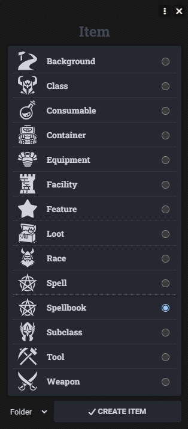
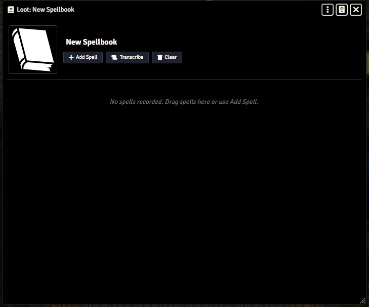
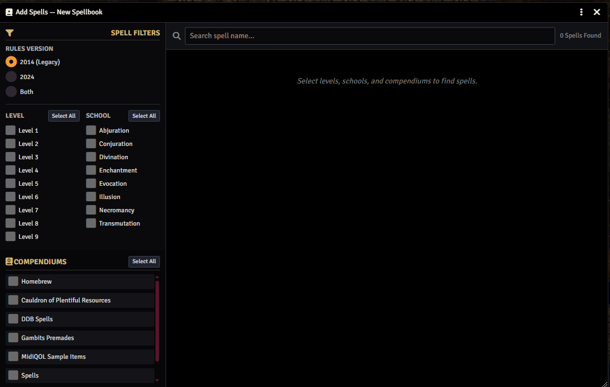
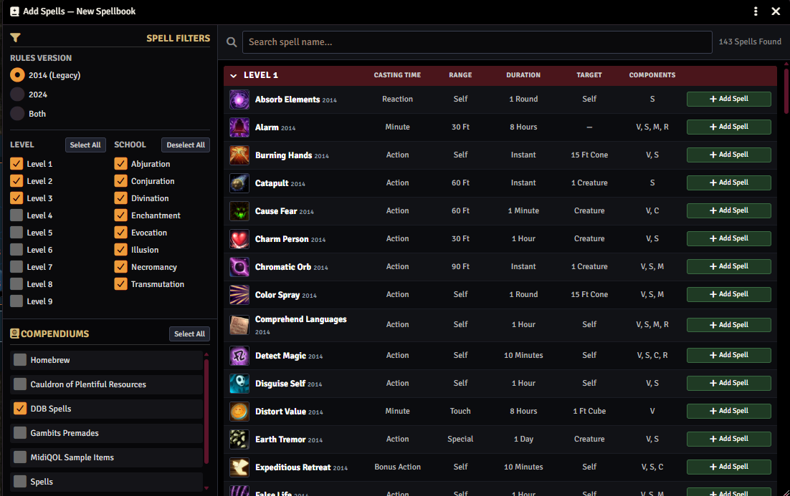
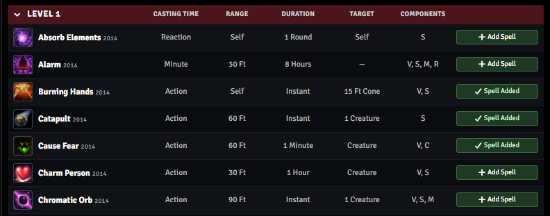
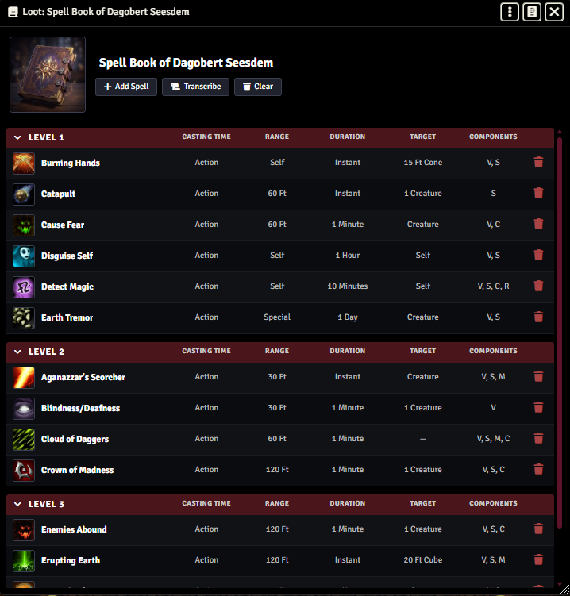
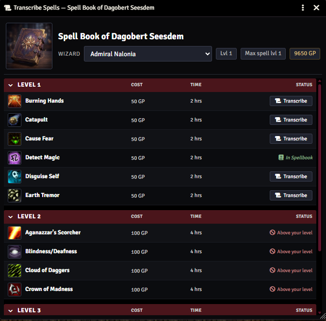
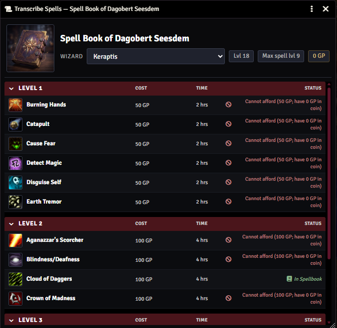
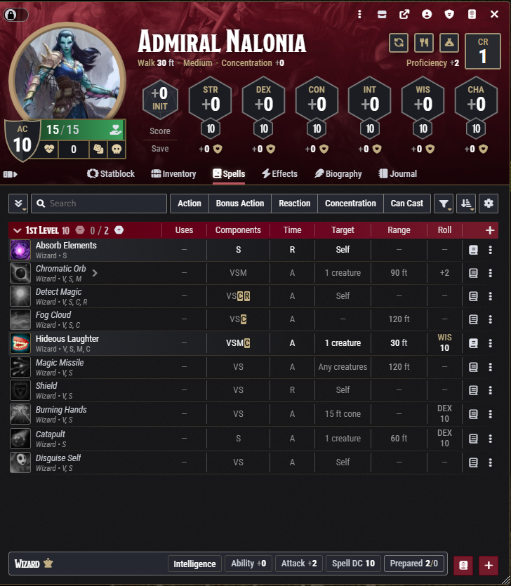

# Tinhead's NPC Spell Book Creator

Ever wanted your NPC wizards to have their own spell book?  Well here's your chance.  
This module creates a lootable NPC spellbook that once found, can be interacted with by the wizard that finds it.  Interactions follow current D&D 5e rules and include costs and durations for transcribing spells into their own spell books.

Once the spellbook is created, the wizard player can see if any spells are currently in their spellbook, any spells that are transcribable or whether they are outside the wizards range.

## Installing the module.

The module can be searched and installed from the foundry add-on module section.  It can also be installed by using the manifest.

## Compatibility

The module is currently compatible with Foundry v13 onwards and DnD v 3.xx onwards

# Creating a Spellbook

The module adds a spellbook option under the create item menu. Add the name of the item to the top, select spellbook and then click create item

You'll then see the new spellbook sheet.  Here you can click the book icon to change the item icon, change the name of the spellbook by clicking 'New Spellbook' or add new spells.  Once you add spells to the book, they will appear here and be ready to transcribe.  You can also clear the spellbook if you add too many spells.

Click Add Spells to open the spell selector sheet.  This may take a moment to load as it checks the compendiums installed in your world.

Once the compendium search is complete, you'll see a four-pane window with options to limit the spells you want to add to the spellbook.
The first window lets you search by 2014, 2024 rules, or both.
The pane below lets you filter spells by level and school of magic.  These update dynamically once you select the spell source (compendiums).
The lower left pane holds the sources for the spells.  Homebrew includes spells that are listed in your world items list.  
Ticking the boxes in any of these three windows will filter the spells you can select from.  Different compendiums may list the same spell.

Spells have tooltips that describe their function, making it easier for the DM to determine whether a spell is suitable for the spellbook.

The spell list shows the casting time, range, duration, target and components for each spell, along with an Add Spell button.  This list is scrollable, as there may be many spells per level depending on the compendiums selected.

Clicking Add Spell adds the required spell to the spellbook sheet and changes the button to read Spell added.  You can also search for spells by name using the search bar at the top.  You can also collapse spell levels to make it easier to select other levels.

Once you have finished adding the spells to the book.  you can close the sheet by clicking the close window [x] in the top-right corner.  This returns you to the spellbook sheet.

Back on the spellbook sheet, you can review the spells you've added.   Bin icons let you remove any spell you added by mistake.  You can also clear the list, add more spells, or transcribe spells to an actor or NPC.

## Transcribing Spells

The DM or player can carry out the transcribing process.  For the DM, when you click the Transcribe button, you can select any wizard actor or NPC currently in the world, and the spells will show which spells they can and cannot transcribe.  It also shows the character's maximum spell level and current funds.  Players can only transcribe spells into their own spellbook.

The monetary and time cost for transcribing the spell are shown in the transcribe sheet, along with whether the spell is already in the character's spellbook or not.  Clicking the transcribe button will add the spell to the player's spellbook and deduct the monetary cost from their wallet.  It is up to the DM to manage the downtime required to transcribe the spell.

Transcribed spells start as unprepared in the spellbook and can be prepared when the wizard next learns their spells.

